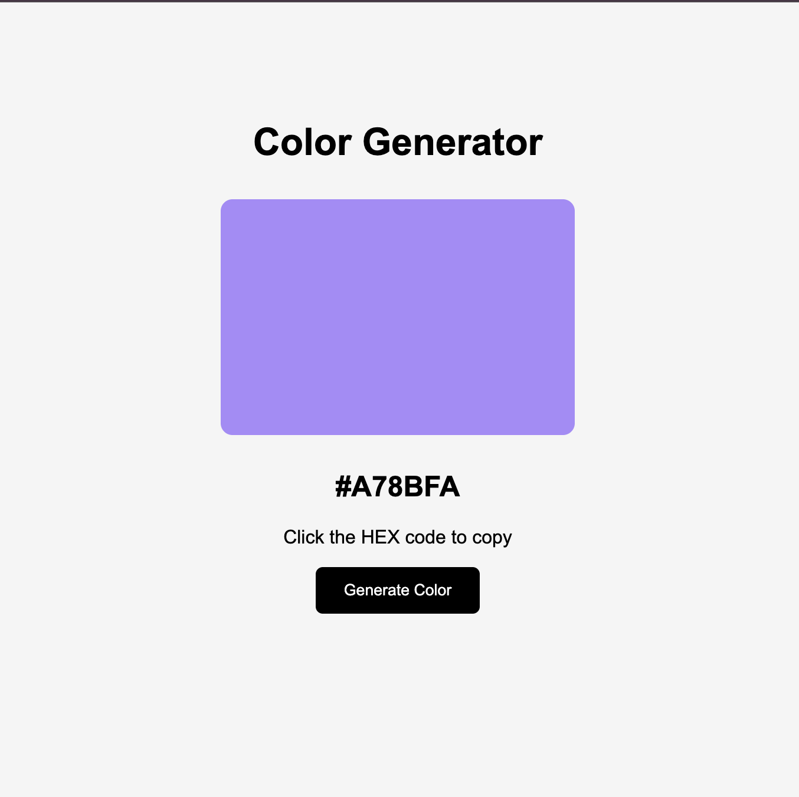

# Random Color Generator

A simple and interactive React application that generates random HEX colors. Users can generate new colors with a button and copy the displayed HEX color code to their clipboard by clicking on it.

The application displays the generated color in a preview box and provides a confirmation message when the color code is copied.

## Preview

### Main Interface



### Random Color Generation


### Copy Color Functionality


## Features

- Generates random HEX color codes.
- Displays the generated color in a preview box.
- Updates the HEX code whenever a new color is generated.
- Copies the HEX code to the clipboard when clicked.
- Displays a confirmation message after copying.
- Simple and beginner-friendly interface.

## Tech Stack

| Technology | Purpose |
|---|---|
| React | Building the user interface |
| JavaScript | Implementing color generation and functionality |
| CSS | Styling the application |
| Vite | Development server and build tool |

## Concepts Practiced

- React functional components
- State management using `useState`
- Updating the UI using React state
- Event handling using `onClick`
- Inline styling in React
- Random number generation using `Math.random()`
- Number conversion using `toString(16)`
- HEX color codes
- Clipboard API using `navigator.clipboard`
- Basic CSS styling

## How to Run

### Prerequisites

- Node.js installed
- npm installed

### Steps

1. Clone the repository:

   ```bash
   git clone https://github.com/keshavsahu17/random-color-generator
   ```

2. Navigate to the project folder:

   ```bash
   cd simple-color-generator
   ```

3. Install dependencies:

   ```bash
   npm install
   ```

4. Start the development server:

   ```bash
   npm run dev
   ```

5. Open the local URL provided in the terminal.

## Production Build

To create a production build:

```bash
npm run build
```

## Project Structure

```text
simple-color-generator/
├── screenshots/
│   ├── 01-main.png
│   ├── 02-random-color.png
│   └── 03-copy-color.png
├── public/
├── src/
│   ├── assets/
│   ├── App.jsx
│   ├── App.css
│   ├── index.css
│   └── main.jsx
├── index.html
├── package.json
├── package-lock.json
└── vite.config.js
```

## Component Overview

| File | Responsibility |
|---|---|
| `App.jsx` | Contains the color generation logic, clipboard functionality, state, and main interface |
| `App.css` | Styles the application elements |
| `index.css` | Contains global styles |
| `main.jsx` | Entry point of the React application |

## Author

**Keshav Sahu**  
Master of Computer Applications (MCA) – AI
